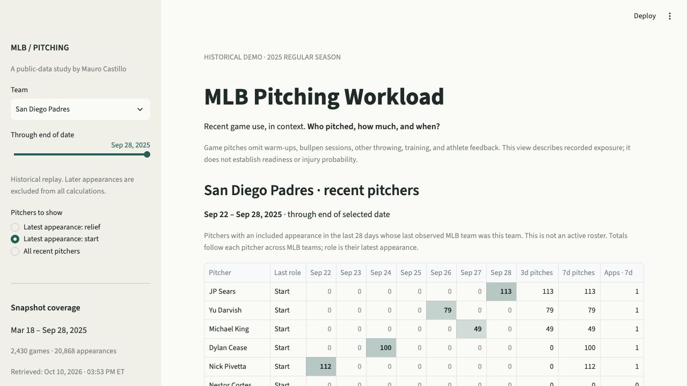

# MLB Pitching Workload

A public-data historical demo for reviewing recorded MLB pitching exposure: who pitched, how much, and when. Built by Mauro Castillo, MD, MS, CSCS, RSCC, CPSS.



## Run locally

The project has its own virtual environment. From this directory:

```sh
.venv/bin/streamlit run app.py --server.port 8502 --server.address 127.0.0.1
```

Open http://127.0.0.1:8502. On a fresh machine, use Python 3.13 and install first:

```sh
python3 -m venv .venv
.venv/bin/python -m pip install -r requirements-dev.txt
```

## What works

- Thirty teams and an end-of-day date slider covering the 2025 regular season.
- A seven-date pitch grid, three/seven-day pitch totals, and recorded appearance counts.
- Filters based on the latest included start/relief appearance.
- Individual outing charts, 7/28-day totals, and previous same-role outing comparisons.
- A deterministic briefing, downloadable CSVs, and source-linked appearance logs.
- An S&C staff review panel: observed game context, tailored questions, a training decision worksheet, and a downloadable handoff.
- Visible historical coverage, retrieval time, missing data, and suspended-game exclusions.

Pitchers are grouped by their last observed team through the chosen date. This is not an active roster. Counts follow players across teams. Days since appearance does not measure rest or recovery.

## Data audit

Snapshot: March 18–September 28, 2025, regular season only. Retrieved October 10, 2026.

| Check | Result |
| --- | ---: |
| Games | 2,430 |
| Team-games | 4,860 |
| Pitching appearances | 20,868 |
| Pitchers | 873 |
| Teams | 30 |
| Pitch/out/batters-faced reconciliation mismatches | 0 |
| Missing core counts | 0 |
| Temporally uncertain suspended/resumed games | 4 |

The roster feed omitted 31 Nick Pivetta starts. A separate league player index recovered those records. Every team-game's player totals then matched the official team totals for pitches, outs, and batters faced. A complete list of games alone would not have caught this omission.

Thirty-six appearance records from four suspended/resumed games remain in the raw snapshot but are excluded from dated calculations. The affected pitchers' original/resumption dates are unknown, so windows crossing those dates are withheld for those pitchers. Unrelated pitchers remain usable. Global source coverage gaps, if present in a future snapshot, withhold totals for everyone.

The source is the [MLB Stats API](https://statsapi.mlb.com/api/v1/teams?sportId=1). Attribution and exact audit details are in `data/metadata.json`. Final corrected records support historical replay; this is not a reconstruction of every statistic as it was known live. No claim is made about current team rosters or athlete status. This independent project is not affiliated with MLB.

## Validation

```sh
.venv/bin/python -m pytest -q
```

Current result: **93 tests passed**, plus 10 parameterized subtests. Tests cover calendar boundaries, trades, doubleheaders, mixed roles, zero-out appearances, missing counts, partial coverage, future leakage, suspended/resumed timing, unrelated-player independence, Streamlit widget reruns, review-note completeness, and draft isolation across players and dates.

An independent direct-sum check matched 216 real trailing totals across 54 Rangers, Marlins, and Yankees pitchers. July 1 checks confirmed affected Boston/Cincinnati pitchers had withheld totals while unaffected teammates and Rangers pitchers remained valid. Team-summary calls took approximately 0.13–0.16 seconds on the development machine.

Browser checks confirmed rendered charts/tables, starter and team switching, and a downloaded Yu Darvish briefing matching the displayed values. The S&C worksheet was filled in the browser and its downloaded Shawn Armstrong review matched the displayed facts and hypothetical inputs. Mobile-specific testing and real-user time savings have not yet been established.

## Refresh

```sh
.venv/bin/python scripts/refresh_data.py --season 2025
# Re-fetch source responses rather than reuse the disk cache:
.venv/bin/python scripts/refresh_data.py --season 2025 --force
```

The app never calls MLB at startup. The refresh process caches and reconciles source responses. An incomplete audit exits with status 2 and records affected dates; the UI withholds affected totals. Snapshot modification times invalidate the app's data cache on the next rerun. The app can load another verified season, but the shipped real-data UI tests intentionally target the 2025 fixture.

Public hosting is not configured. The entrypoint is `app.py`; runtime dependencies are in `requirements.txt`. Review MLB data-use terms and hosting configuration before publishing a redistributed snapshot. The local app is ready for review.

## What this does not measure

Game counts omit warm-ups, bullpen sessions, long toss, other throwing, training, minor-league/rehab appearances, and athlete feedback. The app does not calculate injury risk, readiness, or clearance. Pitch Smart youth rest cutoffs are not applied to MLB.

## Use the S&C staff review

Choose a pitcher and historical date, then scroll below the outing chart. Start with one specific training question. Record unresolved context, a proposed decision, reasoning, a follow-up owner, and the next check. A note can remain useful while questions are unresolved; its status describes documentation, never the athlete's readiness.

This public demo accepts hypothetical practice reasoning. It does not obtain private throwing, training, or athlete-response data. Drafts stay in Streamlit session memory, separately for each player, team, date, and snapshot; reloads or a new session may lose them. Download the text note to keep it. Nothing in the worksheet is saved to the project's data files.

The focus is S&C planning around observed pitching. It does not measure position-player running, hitting, catching, or fielding demands. See [the S&C usefulness review](docs/SC_REVIEW_VALIDATION.md) for tested scenarios and a short practitioner trial.

## Next usefulness check

Pick one familiar team and week. Trace a recent total to games, then use the S&C panel to write a specific question and staff handoff. The intended benefit is less lookup work and a clearer review; both still need to be tested with Mauro before adding metrics. See `docs/PRODUCT_REVIEW.md` for the original stress test and acceptance tasks.
