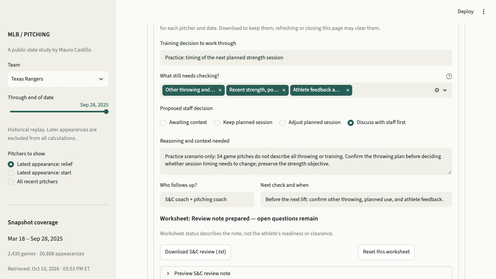

# S&C staff review: usefulness and validation

## What this adds

The panel supports a pitching-specific S&C planning conversation: recorded game use → missing context → a training objective → a proposed decision → an owner and follow-up. Its useful output is a review note that another practitioner can understand and act on.

This is a public historical demo and practice worksheet. The user-entered reasoning is hypothetical, not verified information about the named player. It does not measure position-player physical workload, total throwing, athlete response, readiness, or injury probability. It cannot determine the right training session from game pitches alone.

## Real cases checked

These facts were reproduced from the current local 2025 snapshot and passed through the panel's context helper. Windows include the selected date.

| Historical case | Recorded facts | Useful behavior checked |
| --- | --- | --- |
| Shawn Armstrong, Texas, September 28 | September 22–28: 54 game pitches across 3 appearances. September 26–28: 39 pitches. Latest outing: September 27, 26 pitches; previous 5 relief outings had a median of 14. Two consecutive appearance dates ended September 27. | Names the actual sequence and asks about other throwing and planned use. It does not infer fatigue or prescribe reduced training. |
| Patrick Corbin, Texas, September 28 | September 22–28: 155 pitches across 2 starts. Latest outing: 90 pitches; previous 5 starts had a median of 85. Start and relief appearances occurred in the longer 28-day window. | Describes the two-start week without a spike alarm. The mixed-role question explicitly identifies its 28-day window. |
| Joe Ryan, Minnesota, May 21 | Seven- and three-day pitch totals are unknown because of suspended/resumed-game date uncertainty. Latest reliably dated included outing: May 16, 99 pitches. Days since appearance is unknown. | Source uncertainty is the first question. Unknown totals do not become zero or support a training adjustment. |
| Carl Edwards Jr., Texas, September 28 | No recorded appearances in the last 7 days. Latest included outing: September 16, 35 pitches. A two-date sequence ended September 16. | The old sequence remains a dated fact and does not drive the current question. No recent MLB appearance does not establish rest or capacity to add work. |
| Ezequiel Duran, Texas, September 28 | No recorded appearances in the last 7 days. Latest included relief appearance: September 6, 3 pitches. | Asks staff to confirm intended role and any planned pitching use. A recorded relief appearance is not treated as proof of a bullpen training role. |

## Issues found and fixed

1. **The fourth decision option was rejected.** The panel offered “Discuss with staff first,” but the helper recognized only three options. Both now use one shared decision list.
2. **Sparse relief records implied a bullpen role.** These cases now ask about intended role and any planned pitching use instead of assuming expected bullpen use.
3. **Mixed-role questions obscured the lookback.** The question now names either the seven-day window or the last 28 days, so it does not appear to contradict the adjacent seven-day facts.

## Validation status

The current automated suite passes **93 tests and 10 subtests**. Checks cover calculation boundaries, conditional prompts, unknown versus zero, note completeness, the separation of public facts and hypothetical reasoning, and draft isolation across player/date changes. A completed worksheet describes documentation status; it never validates the athlete or the proposed training decision. Unresolved questions remain visible in the note.

The desktop browser check passed: a complete hypothetical Armstrong worksheet accepted “Discuss with staff first,” retained unresolved questions, and displayed “Review note prepared — open questions remain.” The downloaded text file was read back and matched the displayed public facts and entered practice reasoning. The rendered fields, status, and export controls were visually checked. Mobile-specific layout and interaction have not been tested.

Scenario and functional tests support the panel's relevance and traceability. They do not establish faster staff work, better programming, adoption, or improved athlete outcomes. Those remain unmeasured.

## Five-minute tryout with Mauro

Use Texas through September 28, 2025, and enter only hypothetical practice reasoning.

1. **Minute 1:** Select Armstrong. Identify one recorded fact that matters to the next planned strength session and one important fact the app cannot tell you.
2. **Minutes 2–3:** Write a concrete training question or objective, leave unresolved context visible, and choose a proposed decision. Add a reason, a follow-up owner, and the next check and when. Keeping the planned session and awaiting context are both legitimate choices.
3. **Minute 4:** Compare Corbin and Edwards. Explain why a two-start week does not automatically require less training and why no recent appearance does not establish rest.
4. **Minute 5:** Return to Armstrong, inspect the restored note, and download it. Read it as if you were the receiving coach: can you identify the objective, what remains unknown, who acts next, and when?

**Success target:** Within five minutes, produce one specific, traceable review note without confusing exposure with readiness, and identify a useful staff question that the pitch total alone did not answer. This is a proposed acceptance target, not a measured result.

**Revise or stop adding features if:** the note merely repeats the game totals, the questions feel interchangeable across cases, essential follow-up is still unclear, or the workflow causes unknown data to be read as rest/readiness. Simplify the prompts and worksheet before adding another metric. If it seems useful, the next evidence needed is a timed comparison against Mauro's usual review method.
